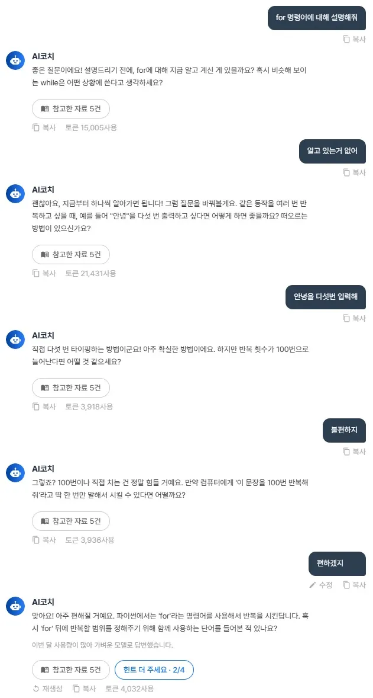
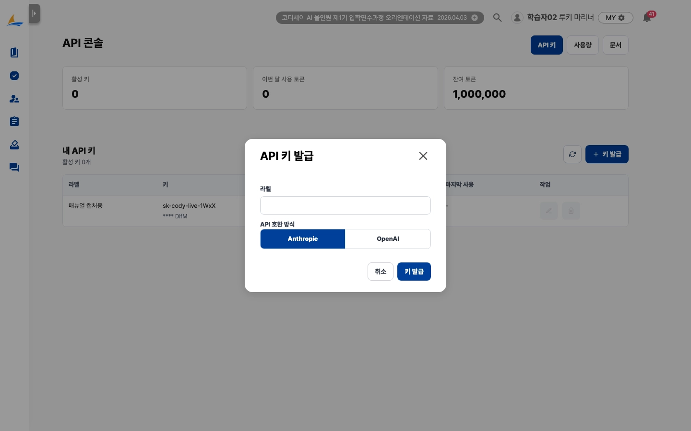
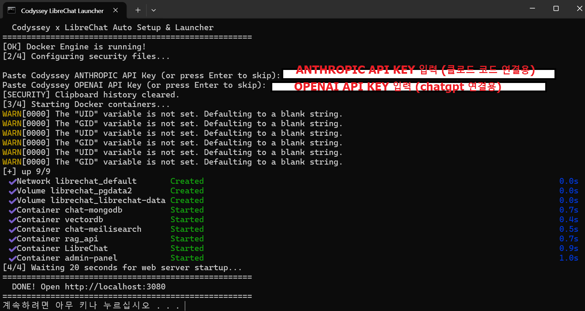
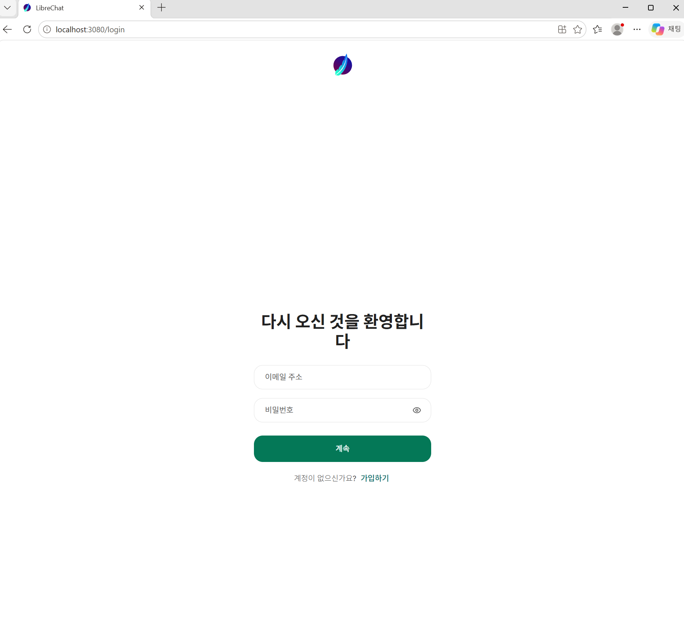
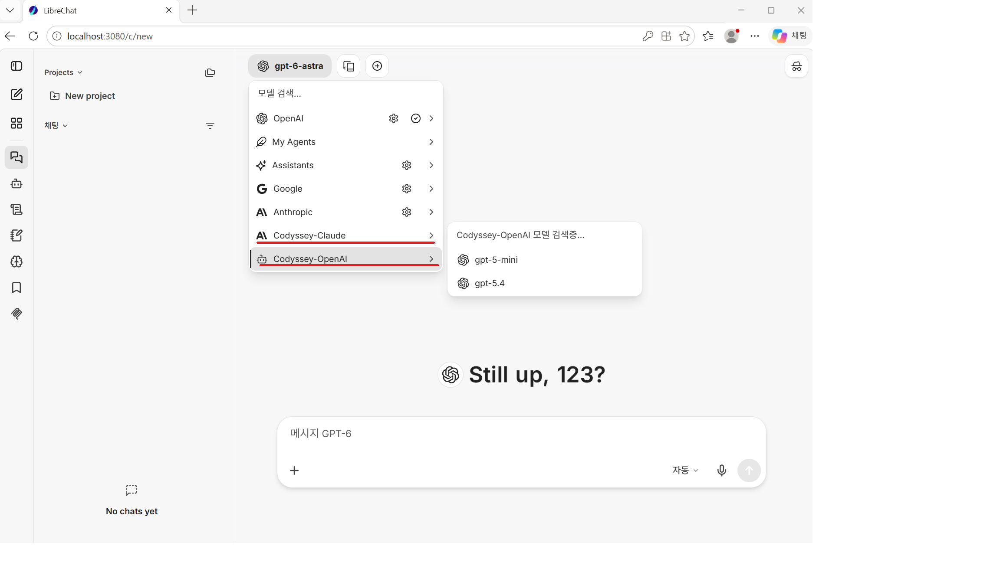
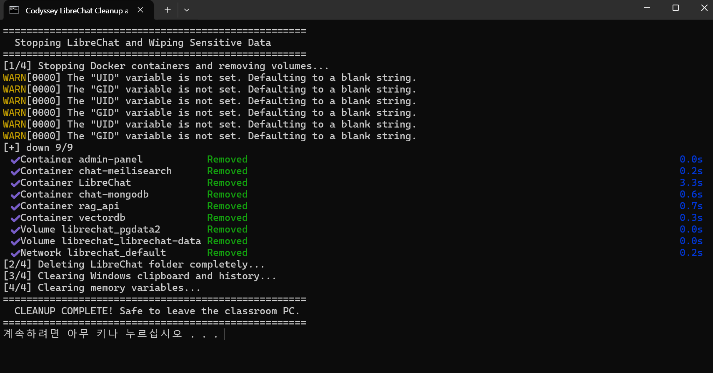
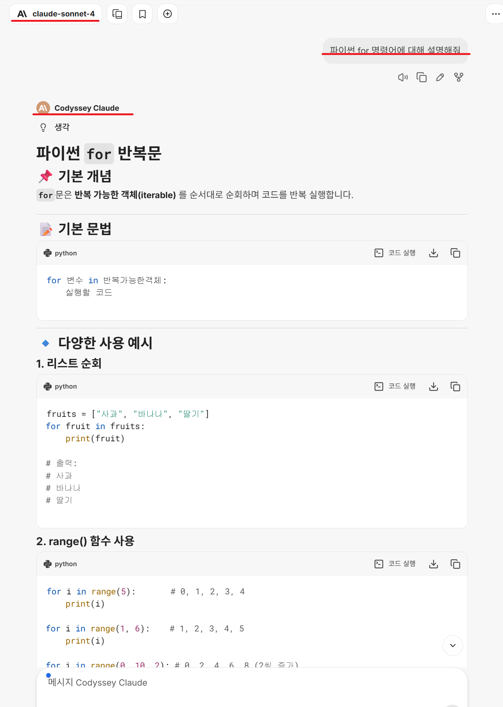
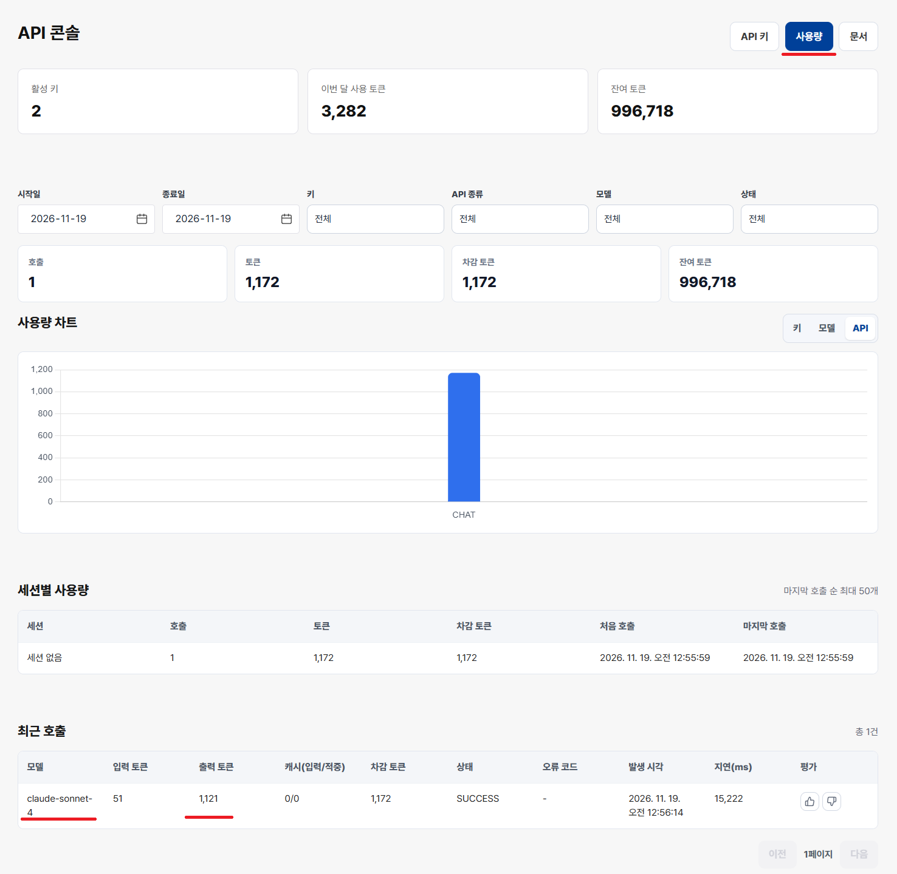

# 네이토에서 벗어나기 (with api-key)

`Codyssey 무료 공개 API 키`와 `LibreChat (오픈소스 로컬 웹 UI)`을 연동해, 공용 강의실 PC에서도 안전하게 Claude와 GPT를 직접 호출해 사용하는 원클릭 자동화 가이드입니다.

---

## 1. 문제 상황: 왜 이 프로젝트를 만들었나?

학습 도중 파이썬 기본 문법인 `for` 반복문이 궁금해서 기본 AI 코치(네이토)에게 질문했을 때의 실제 상황입니다.

* **기대한 것:** `for` 문의 개념과 간단한 예제 코드
* **현실:** 답은 안 알려주고 *"for에 대해 알고 계신 게 있나요?"*, *"100번 치면 어떨 것 같으세요?"* 하며 5턴 넘게 스무고개를 진행하고, 정작 핵심 설명도 듣기 전에 **토큰만 약 48,000개 소모**



결국 **코디세이에서 무료로 발급해 주는 공개 API 키를 연결해, 내가 원하는 AI(Claude, GPT)에게 직접 질문할 수 있는 채팅 UI(BYOK 클라이언트)를 띄우자**는 결론에 도달했습니다.

---

## 2. 대안 비교: 왜 LibreChat을 선택했는가?

발급받은 API 키를 연결해 쓸 수 있는 오픈소스/무료 채팅 UI 도구 3가지를 보안과 신뢰성 기준으로 비교했습니다.

| 후보 프로그램 | 개발 주체 | 실행 방식 | 선택 / 제외 이유 |
|---|---|---|---|
| **Cherry Studio** | 중국 기반 오픈소스 팀 | 윈도우 설치형 앱 | 기능은 풍부하나 중국 기반 프로젝트에 대한 보안 우려로 제외 |
| **Chatbox** | 중국 기반 개발사 | 윈도우 설치형 앱 | 설치는 간편하나 동일하게 중국 기반 프로젝트여서 제외 |
| **LibreChat (채택)** | **캐나다/서구권 커뮤니티** | **Docker 로컬 컨테이너** | **100% 오픈소스이며 내 PC의 격리된 Docker 안에서만 구동되므로 보안과 통제권이 가장 확실함** |

---

## 3. 전체 동작 아키텍처 (시각화)

내 PC의 Docker 컨테이너 내부에 LibreChat 웹 서버와 DB를 띄우고, 외부 제3자 서버를 거치지 않고 Codyssey API 서버와 직접 통신하는 구조입니다.

```text
┌─────────────────────────────────────────────────────────────────┐
│  [내 컴퓨터 (Windows 로컬 환경)]                                 │
│                                                                 │
│   ┌──────────────────┐         ┌─────────────────────────────┐  │
│   │  웹 브라우저      │ ──────▶ │  Docker 컨테이너             │  │
│   │ (localhost:3080) │ ◀────── │  (LibreChat 웹 서버 + DB)   │  │
│   └──────────────────┘         └──────────────┬──────────────┘  │
│                                               │                 │
│        ▲ 설정 자동 주입                        │ API 키 + 질문    │
│        │ (.env / librechat.yaml)              ▼                 │
└────────┼──────────────────────────────────────┼─────────────────┘
         │                                      │ (HTTPS 암호화 통신)
  [로컬 임시 폴더]                               ▼
  - start 실행 시 자동 생성          ┌─────────────────────────────┐
  - end 실행 시 흔적 없이 삭제       │   Codyssey 공개 API 서버     │
                                    │  (copa.codyssey.kr)         │
                                    └──────┬───────────────┬──────┘
                                           │               │ (기관 무료 한도 차감)
                                           ▼               ▼
                                    ┌────────────┐  ┌────────────┐
                                    │   Claude   │  │   OpenAI   │
                                    │ (Anthropic)│  │   (GPT)    │
                                    └────────────┘  └────────────┘
```

---

## 4. 사전 준비물 및 레포지토리 구성

* **사전 설치 필요:** [Git for Windows](https://git-scm.com/), [Docker Desktop](https://www.docker.com/products/docker-desktop/)
* **레포지토리 내부 구조:**

```text
📂 escape-from-neito
 ├── 📄 README.md
 ├── 📁 images                # 가이드 스크린샷 폴더
 ├── ⚙️ start_librechat.bat   # 자동 설치, 키 주입, Docker 및 브라우저 실행
 └── ⚙️ end_librechat.bat     # 컨테이너·DB 삭제, 키·폴더 영구 파기, 클립보드 초기화
```

---

## 5. 실행 방법 (Step-by-Step)


### 0단계: Codyssey API 키 발급
1. Codyssey 로그인 상태에서 `/public-api-console` 페이지로 이동합니다.
2. **API 키** 탭에서 `+ 키 발급`을 누르고 **Anthropic** (Claude용) 및 **OpenAI** (GPT용) 키를 각각 발급받습니다. *(한쪽만 발급받아도 정상 동작합니다.)*
   * ⚠️ 키 원문은 발급 직후 **단 한 번만** 표시되므로 즉시 복사해 두세요.




### 1단계: 레포지토리 다운로드 (`git clone`)
터미널(CMD 또는 PowerShell)을 열고 원하는 위치(예: 바탕화면)에서 아래 명령어를 입력해 배치 파일을 내려받습니다.

```bash
git clone https://github.com/Genie1486/escape-from-neito.git
cd escape-from-neito
```


### 2단계: `start_librechat.bat` 실행
1. 내려받은 폴더 안의 **`start_librechat.bat`** 파일을 더블클릭합니다. (Docker Desktop이 꺼져 있다면 자동으로 켜고 엔진이 준비될 때까지 대기합니다.)
2. 터미널 창에 안내가 뜨면 발급받은 **Anthropic API 키**와 **OpenAI API 키**를 각각 붙여넣고 `Enter`를 누릅니다. *(사용하지 않을 키는 그냥 `Enter`를 눌러 건너뛸 수 있습니다.)*
   * 🔒 보안을 위해 키를 입력하는 즉시 **윈도우 클립보드 및 `Win + V` 복사 기록이 자동으로 삭제**됩니다.
3. 브라우저가 열리면 콘솔창은 닫아도 됩니다. (Enter 입력)



### 3단계: 브라우저에서 로컬 회원가입 및 로그인
1. 약 20초 뒤 자동으로 열리는 `http://localhost:3080` 화면에서 **Sign up**을 눌러 계정을 생성합니다.
2. 이 계정은 외부 서버가 아닌 **내 PC Docker 내부 로컬 DB에만 저장**되므로, 이메일 인증 없이 `test@local.com` / `12345678` 같은 아무 테스트 값이나 입력해서 가입하면 됩니다.
3. 로그인 후 상단 모델 선택창에서 **Codyssey Claude** 또는 **Codyssey OpenAI**를 선택해 대화를 시작합니다.





### 4단계: 강의실 퇴실 시 `end_librechat.bat` 실행 (필수)
공용 PC에 내 API 키와 대화 기록이 남지 않도록, 자리를 비울 때 반드시 **`end_librechat.bat`**을 더블클릭합니다.
* 실행 중인 Docker 컨테이너 및 로컬 DB 볼륨 삭제 (`docker compose down -v`)
* `.env` (API 키)가 포함된 `LibreChat` 폴더 전체 영구 삭제
* 윈도우 클립보드 및 메모리 변수 초기화



---

## 6. 적용 결과 확인

### ① LibreChat에서 동일한 반복문 질문 결과
스무고개 없이 곧바로 `for` 문의 핵심 개념, 기본 문법, 실행 예제를 깔끔하게 답변해 줍니다.



### ② Codyssey 콘솔 API 사용 내역 반영 확인
Codyssey 공개 API 콘솔의 **사용량 / 호출 내역** 탭에서 방금 호출한 모델(`claude-haiku-4`, `gpt-5-mini` 등)과 토큰 차감 내역이 정상적으로 기록되는 것을 확인할 수 있습니다.



---

## 7. 사용 시 주의사항 및 토큰 절약 팁

* **보안 주의:** Codyssey 운영 정책상 공개 API를 통해 오간 **모든 질문과 응답 내역은 소속 기관 운영자가 열람할 수 있습니다.** 개인정보나 민감한 비밀 내용은 절대 입력하지 마세요.
* **주제가 바뀌면 `+ 새 채팅 (New Chat)` 누르기:** 한 채팅방에서 대화가 길어지면 이전 대화 내역까지 매번 함께 전송되어 무료 토큰 한도가 빠르게 줄어듭니다.
* **가벼운 질문은 `claude-haiku-4` 활용:** 차감 가중치가 `0.5배`로 설정되어 있어 `sonnet (1배)`이나 `opus (1.5배)`보다 토큰을 2배 더 오래 사용할 수 있습니다.